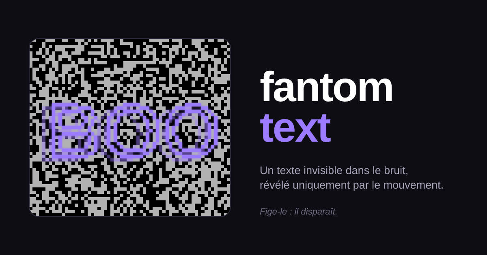
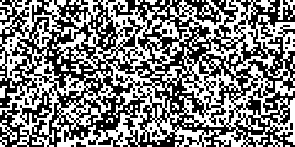

<p align="center">
  
</p>

<p align="center">
  A tiny embeddable widget that hides a text in black and white noise.<br />
  You can read it while it moves. Freeze it, and it's gone.
</p>

<p align="center">
  <a href="https://fantom-text.vercel.app/"><strong>👻 Live demo →</strong></a>
</p>

<p align="center">
  <a href="#how-it-works">How it works</a> ·
  <a href="#usage">Usage</a> ·
  <a href="#backgrounds">Backgrounds</a> ·
  <a href="#javascript-api">API</a> ·
  <a href="#development">Development</a> ·
  <a href="#license">License</a>
</p>

---

<p align="center">
  
</p>

<p align="center">
  <sub>
    The actual engine, replayed offline. Any single frame of this GIF is pure
    noise; pause it and see. Regenerate with <code>make build-preview</code>.
  </sub>
</p>

## How it works

The canvas is filled with random black and white cells. On every tick, the
cells under the text's outline are **inverted**. Since the noise is random,
an inverted patch of noise is just more noise: no single frame contains the
text. But as the text drifts, your visual system picks up the coherent moving
pattern of flips and reads it effortlessly.

It's the persistence-of-vision trick from
[optical.toys "POV static cube"](https://optical.toys/persistance-of-vision-static-cube/),
applied to arbitrary text.

> Fun fact: this started as a CAPTCHA experiment ("capcha-fantom"). Humans
> read it fine, but a bot only needs to diff two consecutive frames to
> recover the text, so it lives on as a toy instead.

## Usage

Drop these two lines into any HTML page:

```html
<div data-fantom-text data-text="BOO"></div>
<script src="https://fantom-text.vercel.app/fantom-text.js"></script>
```

That's it: a single file, ~5 KB minified, zero dependencies. The script scans
the page on load for every `[data-fantom-text]` element and mounts a canvas
inside it (or renders directly into it when the element is itself a
`<canvas>`). Click the canvas to freeze or resume the motion.

| Attribute         | Description                                                | Default   |
| ----------------- | ---------------------------------------------------------- | --------- |
| `data-text`       | The hidden text.                                           | `FANTOM`  |
| `data-background` | Background strategy, see [Backgrounds](#backgrounds).      | `static`  |
| `data-mode`       | `outline` or `fill`: which cells flip (static only).       | `outline` |
| `data-width`      | Canvas width in pixels (it shrinks to fit narrow screens). | `640`     |
| `data-height`     | Canvas height in pixels.                                   | `320`     |

For screen readers, the canvas gets `role="img"` and an `aria-label` holding
the text, since nobody can read it on a still frame.

## Backgrounds

| Value       | What moves                                                                 | Feel                     |
| ----------- | -------------------------------------------------------------------------- | ------------------------ |
| `static`    | Fixed noise; only the cells under the drifting, gently rocking text flip.  | The original toy, crisp. |
| `oscillate` | One noise texture sways: the background horizontally, the text vertically. | Calm, almost hypnotic.   |

## JavaScript API

Everything is exposed on `window.FantomText`:

```js
const ghost = window.FantomText.mount(element, {
  text: "BOO",
  background: "oscillate",
  width: 480,
  height: 240,
});

ghost.setText("HELLO"); // swap the text without restarting
ghost.controller.stop(); // also start(), toggle(), running()
ghost.destroy(); // stop and clean up

window.FantomText.scan(); // mount any [data-fantom-text] added later
```

`mount` options mirror the attributes, plus engine tuning:

| Option          | Description                                           | Default       |
| --------------- | ----------------------------------------------------- | ------------- |
| `cellSize`      | Noise cell size in pixels.                            | `5`           |
| `fontSize`      | Text size in pixels.                                  | `130`         |
| `fontFamily`    | Text font.                                            | `system-ui`   |
| `speed`         | Drift speed in pixels per tick (static).              | `1.4`         |
| `rotationSpeed` | Rocking speed in radians per tick.                    | `0.01`        |
| `maxRotation`   | Maximum tilt in radians (capped at `PI / 2`).         | `PI / 8`      |
| `oscAmplitude`  | Sway amplitude in cells (oscillate).                  | `4`           |
| `stepMs`        | Minimum milliseconds between ticks; higher is calmer. | `55`          |
| `pauseOnClick`  | Freeze / resume when the canvas is clicked.           | `true`        |
| `rng`           | Random source, injectable for deterministic noise.    | `Math.random` |

## Development

Requires Node 24 (pinned in `.nvmrc`, run `nvm use`).

```bash
make install        # install npm dependencies
make dev            # Vite dev server on :3108 + esbuild watch on the snippet
make check          # lint + typecheck + format-check + tests (CI command)
make build          # build snippet + Vue demo into dist/
make build-og       # regenerate og.svg, og.png and favicon.svg
make build-preview  # regenerate the animated README preview
```

The snippet is compiled by esbuild from `src/snippet/` into
`public/fantom-text.js`, which Vite serves as-is and ships in `dist/`. The
demo page loads that same bundle, so it shows exactly what host pages get.
Deploying `dist/` on any static host is enough: there is no backend.

## Project structure

```
src/
  snippet/
    fantom-text.ts    # entry point: mount / scan / window.FantomText
    pov.ts            # the canvas engine (static / oscillate backgrounds)
    geometry.ts       # pure helpers: text shape, bounce, ping-pong, noise
  components/
    FantomCanvas.vue      # demo wrapper around window.FantomText.mount
    WorkshopPanel.vue     # live settings playground
    IntegrationGuide.vue  # copy-paste snippet + attributes
  App.vue             # Vue demo page: header, gallery, footer
  site.ts             # site and repository URLs
scripts/
  build-og.ts         # generate og.svg, og.png and favicon.svg
  build-preview.ts    # replay the engine offline into preview.gif
  raster.ts           # shared helpers (seeded RNG, text mask via resvg)
public/
  fantom-text.js      # the embeddable snippet (generated by esbuild)
  og.svg / og.png     # social preview (generated)
  preview.gif         # README animation (generated)
  favicon.svg         # site icon (generated)
tests/                # vitest unit + DOM tests
```

## License

[MIT](./LICENSE) © YavaDeus
